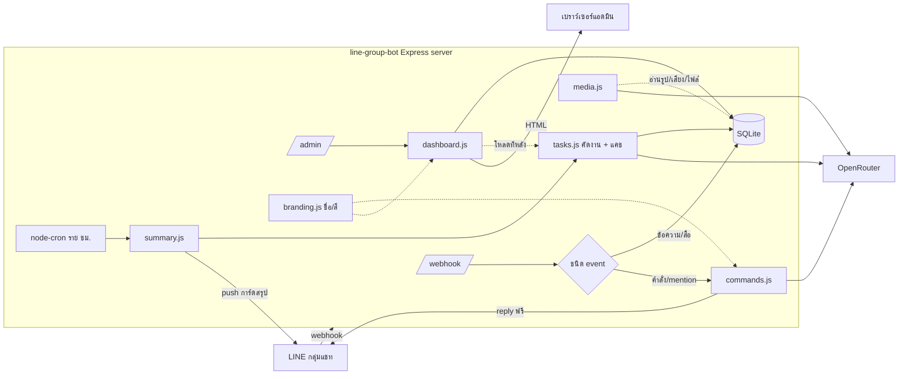
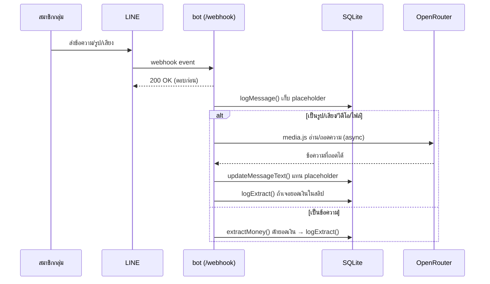
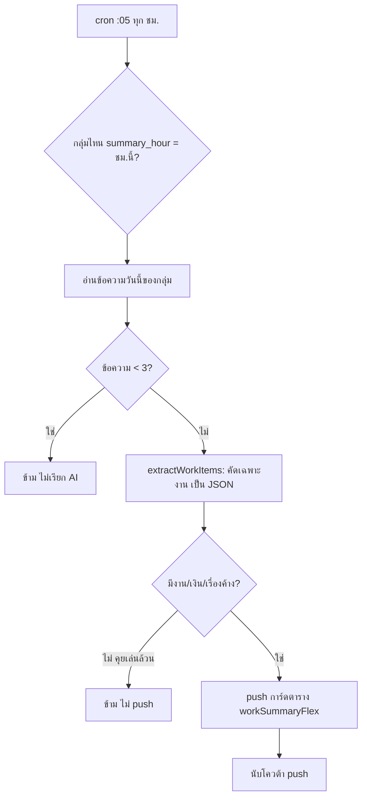
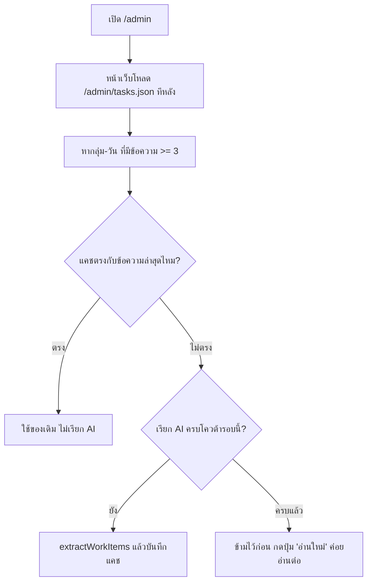

# สถาปัตยกรรม & Workflow ทั้งหมด

เอกสารนี้อธิบายว่าข้อมูลไหลยังไงตั้งแต่มีคนพิมพ์ในกลุ่ม จนถึงสรุปรายวัน + แดชบอร์ด

## ภาพรวมระบบ



## 1) ข้อความเข้ากลุ่ม → เก็บ log

ทุกข้อความในกลุ่มเข้าที่ `/webhook` (ตรวจ signature ด้วย `LINE_CHANNEL_SECRET`) แล้วบันทึกลงตาราง `messages` ทันที ตอบ HTTP 200 กลับ LINE ก่อนเพื่อกัน timeout แล้วค่อยประมวลผลเบื้องหลัง



- **ไม่มี API อ่านย้อนหลัง** — LINE ให้บอทเห็นเฉพาะข้อความ *หลัง* เข้ากลุ่มเท่านั้น
- สื่อ (รูป/เสียง/วิดีโอ/ไฟล์) เก็บเป็น placeholder ก่อน แล้ว `media.js` ค่อยอ่านตัวจริงแบบ async (ไม่บล็อก webhook)
- คนกด **unsend** → บอทลบ log ข้อความนั้นตาม (`deleteByLineMsgId`)

## 2) คำสั่ง / mention → ตอบในกลุ่ม (ฟรี)

ข้อความที่ขึ้นต้น `!` หรือ mention บอท จะเข้า `commands.js` แล้วตอบกลับด้วย **reply token** (ไม่กินโควต้า push)

| คำสั่ง | ทำอะไร | ใช้ AI ไหม |
|---|---|---|
| `!สรุป` / `!สรุปเมื่อวาน` | สรุปแชทเป็นการ์ด | ✅ |
| `!ค้น <คำ>` | ค้นข้อความย้อนหลัง | ❌ |
| `!ถาม <คำถาม>` / @บอท | ถาม AI จากประวัติแชท | ✅ |
| `!ยอดเงิน` | ยอดเงินที่จับได้วันนี้ | ❌ |
| `!สรุปอัตโนมัติ เปิด/ปิด`, `!เวลาสรุป <0-23>` | ตั้งค่าสรุปรายวัน | ❌ |

## 3) สรุปงานรายวันอัตโนมัติ

`node-cron` เดินทุกชั่วโมง (นาที :05) เช็คว่ากลุ่มไหนถึงเวลาสรุป (`summary_hour`) แล้ว push การ์ดตารางเข้ากลุ่ม



จุดสำคัญที่ทำให้ **ประหยัด**:
- วันเงียบ (`< 3` ข้อความ) ไม่เรียก AI เลย
- วันคุยเล่นล้วน (AI คืน JSON ว่าง) เรียก AI แต่ไม่ push
- push สรุปกิน **1 ครั้ง/กลุ่ม/วัน** — โควต้าฟรี LINE 300/เดือน (เตือนที่ 250)

## 4) แดชบอร์ด `/admin`

`dashboard.js` query ตาราง `messages` / `extracts` / `groups` / `members` แบบสดทุกครั้งที่เปิด แล้ว render HTML ป้องกันด้วย `ADMIN_KEY`

หน้าเรียงจากบนลงล่างตามลำดับที่คนเปิดดูอยากรู้:

1. **แถบฟิลเตอร์** — ช่วงเวลา (`?range=today|7|30`) × กลุ่ม (`?group=<id>`) ทุกส่วนบนหน้าขยับตามฟิลเตอร์ทั้งหมด
2. **สรุปผลเป็นประโยคภาษาคน** — คิดจากตัวเลขตรงๆ ไม่เรียก AI ไม่เสียเงิน
3. **การ์ด ✅ งานที่ต้องทำ** — งานค้างรวมทุกกลุ่ม พร้อมแท็ก กลุ่ม/ผู้รับผิดชอบ/กำหนด/ค้างมากี่วัน
4. KPI 4 ใบ + กราฟ + ตารางเฉพาะกลุ่มที่คุยจริง (กลุ่มเงียบพับเก็บ)
5. ของระบบ (โควต้า push, ยอดสะสม, ลิงก์สำรองข้อมูล) ยุบไว้ล่างสุด

### งานที่ต้องทำมาจากไหน — และทำไมเปิดซ้ำไม่เสียเงินเพิ่ม

`tasks.js` แคชผลที่ AI คัดไว้ลงตาราง `work_items` คู่กับ id ข้อความล่าสุดของวันนั้น



- หน้าเว็บไม่ค้างรอ AI เพราะโหลดงานแยกทีหลังผ่าน `/admin/tasks.json`
- เพดานเรียก AI 8 กลุ่ม-วันต่อการเปิดหนึ่งครั้ง (ปุ่ม "อ่านใหม่" = อ่านสด เพดาน 12)
- **การ์ดสรุป 20:00 ใช้ `tasks.js` ตัวเดียวกัน** เลยแชร์แคชกับแดชบอร์ด — ถ้าแดชบอร์ดคัดไว้แล้ว ตอนส่งสรุปไม่ต้องเรียก AI ซ้ำ
- เลือก "วันนี้" แล้วยังไม่มีใครคุย → ถอยไปหยิบงานค้าง 7 วันล่าสุดมาโชว์แทนพร้อมหมายเหตุ

## 5) หน้าภาพรวมกลุ่ม `/admin/overview`

การ์ดหนึ่งใบต่อหนึ่งกลุ่ม บอกว่าวันนั้นกลุ่มนั้นคุยอะไรกันบ้าง ใครคุยเยอะ มีสื่อ/ยอดเงินกี่ชิ้น — เลือกย้อนดูรายวันได้

- โครงหน้าเรนเดอร์ก่อน แล้วแต่ละการ์ดค่อยดึงสรุปของตัวเองผ่าน `/admin/overview/digest.json` ทีละกลุ่ม
- `digest.js` แคชผลลง `digests` เทียบ id ข้อความล่าสุดเหมือน `tasks.js` — เปิดซ้ำไม่เรียก AI ใหม่
- กลุ่มที่คุยกันไม่กี่บรรทัด (< 3 ข้อความ) โชว์ข้อความจริงไปเลย ไม่เปลืองค่า AI
- วันที่พิมพ์มั่ว (31 ก.พ.) หรือวันในอนาคต ระบบถอยกลับมาเป็นวันนี้เอง

## 6) ชื่อบอทกับโทนสี

`branding.js` อ่าน `BOT_NAME` / `BOT_SELF` / `BOT_THEME` / `BOT_EMOJI` / `BOT_POLITE` จาก `.env` ครั้งเดียวตอนบูต แล้วไฟล์อื่นดึงไปใช้ — ไม่มีไฟล์ไหนฮาร์ดโค้ดชื่อบอทหรือรหัสสีไว้เอง

- ข้อความบนการ์ดทุกบรรทัดผ่าน `say()` และข้อความธรรมดาผ่าน `toMessages()` → ตั้ง `BOT_POLITE=ชาย` ครั้งเดียวคำลงท้ายเปลี่ยนทั้งบอท
- คำแทนตัวเองเดาจากชื่อให้ (`น้อง...` → "น้อง", `พี่...` → "พี่", ชื่ออื่น → ชื่อเต็ม)
- เพิ่มธีมสีใหม่ = เพิ่มก้อนใน `THEMES` ของ `branding.js` ไฟล์เดียว

## โครงสร้างโค้ด

```
src/
  branding.js   ชื่อบอท / คำแทนตัว / อิโมจิ / โทนสี — ที่เดียวที่กำหนดตัวตนบอท
  index.js      webhook + routes /admin, /admin/tasks.json, /admin/summary, /admin/backup
  db.js         SQLite: groups / members / messages / extracts / pushes / work_items / digests
  commands.js   คำสั่งในกลุ่ม (คืน string หรือการ์ด Flex)
  tasks.js      คัดงานที่ต้องทำ + แคชผล AI ต่อ (กลุ่ม, วัน)
  digest.js     สรุปว่าแต่ละกลุ่มคุยอะไรกันในวันนั้น + แคชแบบเดียวกัน
  ai.js         OpenRouter: สรุป / ตอบคำถาม / คัดงานเป็น JSON
  media.js      อ่านรูป/เสียง/วิดีโอ/ไฟล์ (โหลดจาก LINE → AI → อัพเดต log)
  extract.js    regex ดักจับยอดเงิน
  flex.js       การ์ด Flex ทุกใบ + ฟอร์แมตวันที่ พ.ศ.
  summary.js    cron สรุปรายวัน + push + สำเนา Telegram (ทางเลือก)
  dashboard.js  หน้าแดชบอร์ด /admin + ภาพรวมกลุ่ม /admin/overview + อ่านสรุป /admin/report
  time.js       dayjs โซนไทย
bin/
  backup-db.sh  ดึงไฟล์ฐานข้อมูลจากคลาวด์มาเก็บในเครื่อง (เก็บ 14 วัน)
scripts/
  seed-mock.js  ใส่ข้อมูลจำลองไว้ลองแดชบอร์ด
test/
  run.js        เทส offline 75 เคส (ชื่อ-ธีม / db / regex / คำสั่ง / การ์ด / แคชงาน / ฟิลเตอร์ / ภาพรวม)
```

## โมเดลต้นทุน

| อย่าง | ต้นทุน |
|---|---|
| ข้อความปกติ, คำสั่ง `!ค้น`/`!ยอดเงิน` | ฟรี (ไม่เรียก AI) |
| `!สรุป`, `!ถาม`, สรุปรายวัน | ~฿0.01/ครั้ง (โมเดลข้อความ) |
| อ่านรูป/เสียง/วิดีโอ | ~฿0.04–0.1/ชิ้น (โมเดล vision) |
| ตอบในกลุ่ม (reply) | ฟรี ไม่กินโควต้า |
| push สรุปรายวัน | นับใน 300/เดือน (ฟรีของ LINE) |
