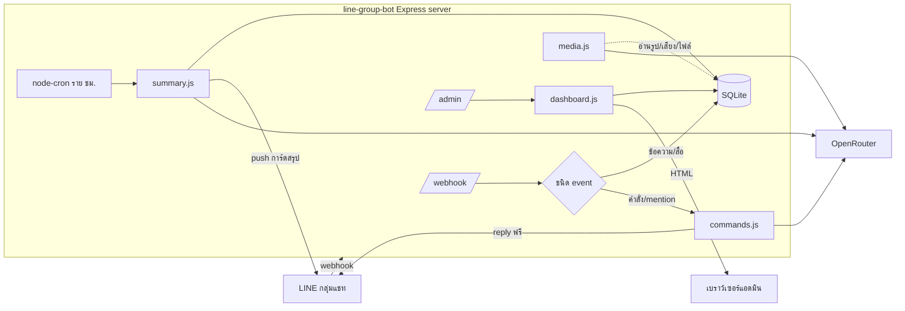
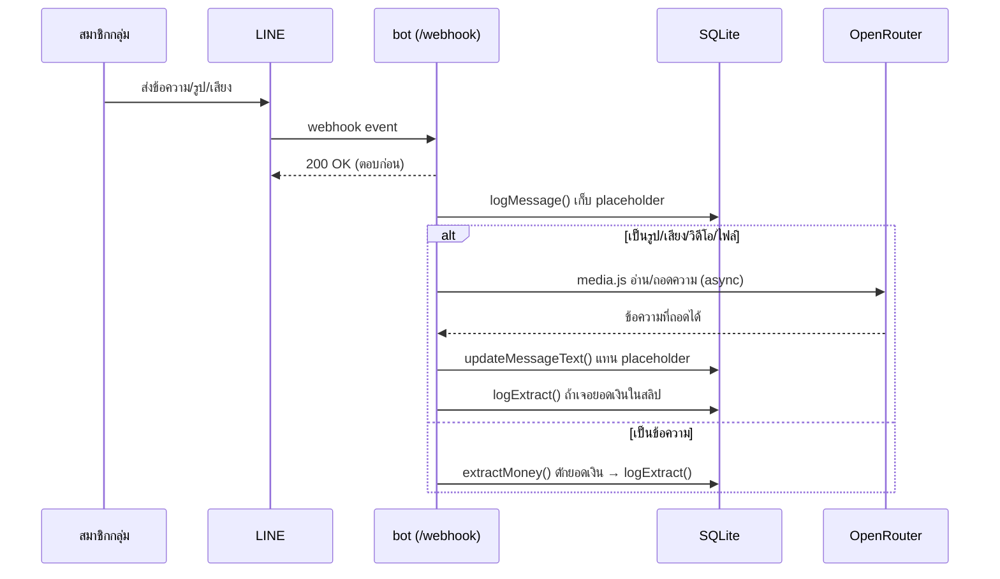
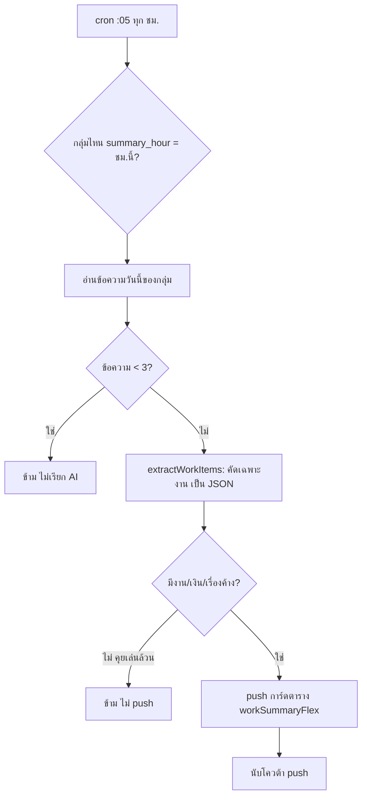

# สถาปัตยกรรม & Workflow ทั้งหมด

เอกสารนี้อธิบายว่าข้อมูลไหลยังไงตั้งแต่มีคนพิมพ์ในกลุ่ม จนถึงสรุปรายวัน + แดชบอร์ด

## ภาพรวมระบบ



## 1) ข้อความเข้ากลุ่ม → เก็บ log

ทุกข้อความในกลุ่มเข้าที่ `/webhook` (ตรวจ signature ด้วย `LINE_CHANNEL_SECRET`) แล้วบันทึกลงตาราง `messages` ทันที ตอบ HTTP 200 กลับ LINE ก่อนเพื่อกัน timeout แล้วค่อยประมวลผลเบื้องหลัง



- **ไม่มี API อ่านย้อนหลัง** — LINE ให้บอทเห็นเฉพาะข้อความ *หลัง* เข้ากลุ่มเท่านั้น
- สื่อ (รูป/เสียง/วิดีโอ/ไฟล์) เก็บเป็น placeholder ก่อน แล้ว `media.js` ค่อยอ่านตัวจริงแบบ async (ไม่บล็อก webhook)
- คนกด **unsend** → บอทลบ log ข้อความนั้นตาม (`deleteByLineMsgId`)

## 2) คำสั่ง / mention → ตอบในกลุ่ม (ฟรี)

ข้อความที่ขึ้นต้น `!` หรือ mention บอท จะเข้า `commands.js` แล้วตอบกลับด้วย **reply token** (ไม่กินโควต้า push)

| คำสั่ง | ทำอะไร | ใช้ AI ไหม |
|---|---|---|
| `!สรุป` / `!สรุปเมื่อวาน` | สรุปแชทเป็นการ์ด | ✅ |
| `!ค้น <คำ>` | ค้นข้อความย้อนหลัง | ❌ |
| `!ถาม <คำถาม>` / @บอท | ถาม AI จากประวัติแชท | ✅ |
| `!ยอดเงิน` | ยอดเงินที่จับได้วันนี้ | ❌ |
| `!สรุปอัตโนมัติ เปิด/ปิด`, `!เวลาสรุป <0-23>` | ตั้งค่าสรุปรายวัน | ❌ |

## 3) สรุปงานรายวันอัตโนมัติ

`node-cron` เดินทุกชั่วโมง (นาที :05) เช็คว่ากลุ่มไหนถึงเวลาสรุป (`summary_hour`) แล้ว push การ์ดตารางเข้ากลุ่ม



จุดสำคัญที่ทำให้ **ประหยัด**:
- วันเงียบ (`< 3` ข้อความ) ไม่เรียก AI เลย
- วันคุยเล่นล้วน (AI คืน JSON ว่าง) เรียก AI แต่ไม่ push
- push สรุปกิน **1 ครั้ง/กลุ่ม/วัน** — โควต้าฟรี LINE 300/เดือน (เตือนที่ 250)

## 4) แดชบอร์ดรายวัน `/admin`

`dashboard.js` query ตาราง `messages` / `extracts` / `groups` / `members` แบบสดทุกครั้งที่เปิด แล้ว render HTML (KPI + กราฟ 14 วัน + ตารางกลุ่ม + ยอดเงินวันนี้) ป้องกันด้วย `ADMIN_KEY`

## โครงสร้างโค้ด

```
src/
  index.js      webhook + routes /admin, /admin/summary, /admin/backup + จุด start
  db.js         SQLite: groups / members / messages / extracts / pushes + helpers
  commands.js   คำสั่งในกลุ่ม (คืน string หรือการ์ด Flex)
  ai.js         OpenRouter: สรุป / ตอบคำถาม / คัดงานเป็น JSON
  media.js      อ่านรูป/เสียง/วิดีโอ/ไฟล์ (โหลดจาก LINE → AI → อัพเดต log)
  extract.js    regex ดักจับยอดเงิน
  flex.js       การ์ด Flex ทุกใบ (โทนฟ้า-ขาว) + ฟอร์แมตวันที่ พ.ศ.
  summary.js    cron สรุปรายวัน + push + สำเนา Telegram (ทางเลือก)
  dashboard.js  หน้าแดชบอร์ด /admin
  time.js       dayjs โซนไทย
scripts/
  seed-mock.js  ใส่ข้อมูลจำลองไว้ลองแดชบอร์ด
test/
  run.js        เทส offline (db / regex / คำสั่ง / การ์ด / แดชบอร์ด)
```

## โมเดลต้นทุน

| อย่าง | ต้นทุน |
|---|---|
| ข้อความปกติ, คำสั่ง `!ค้น`/`!ยอดเงิน` | ฟรี (ไม่เรียก AI) |
| `!สรุป`, `!ถาม`, สรุปรายวัน | ~฿0.01/ครั้ง (โมเดลข้อความ) |
| อ่านรูป/เสียง/วิดีโอ | ~฿0.04–0.1/ชิ้น (โมเดล vision) |
| ตอบในกลุ่ม (reply) | ฟรี ไม่กินโควต้า |
| push สรุปรายวัน | นับใน 300/เดือน (ฟรีของ LINE) |
